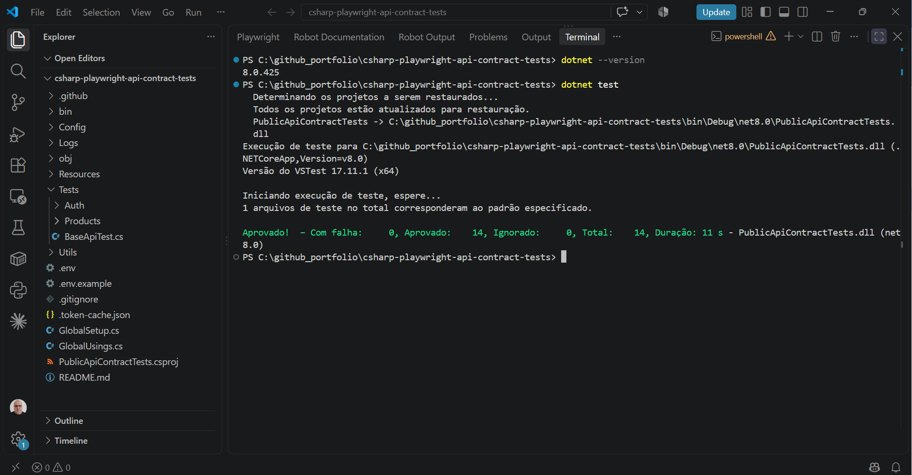
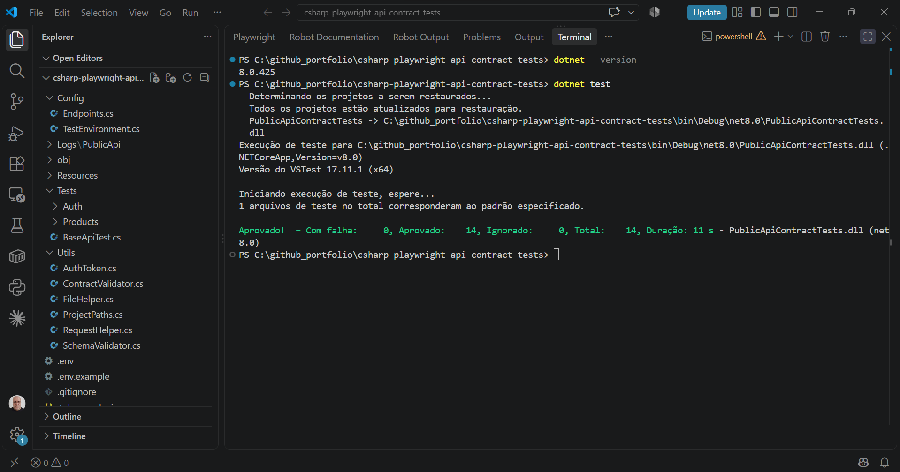
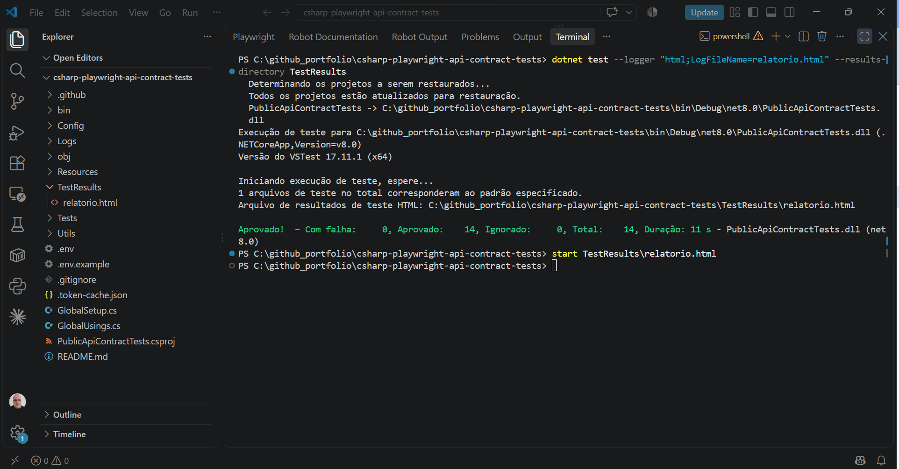
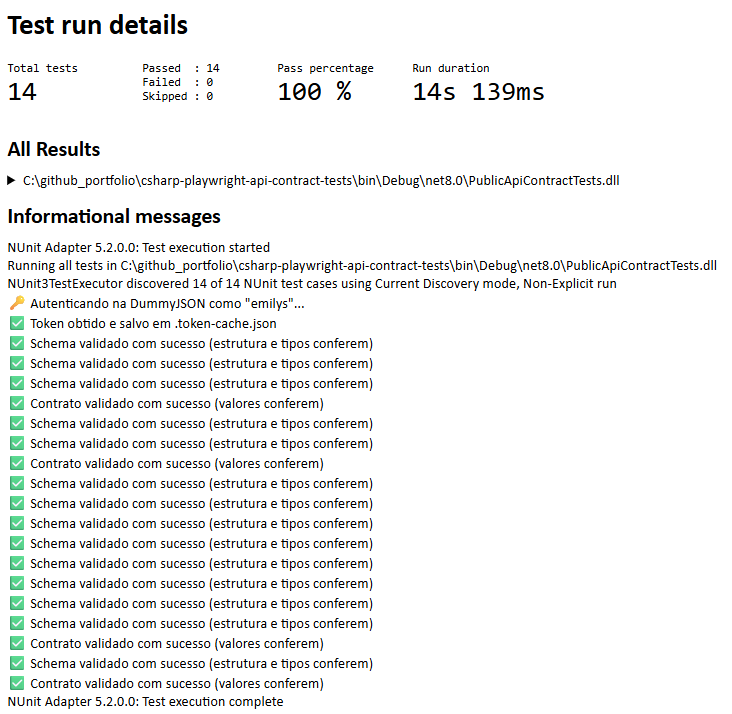
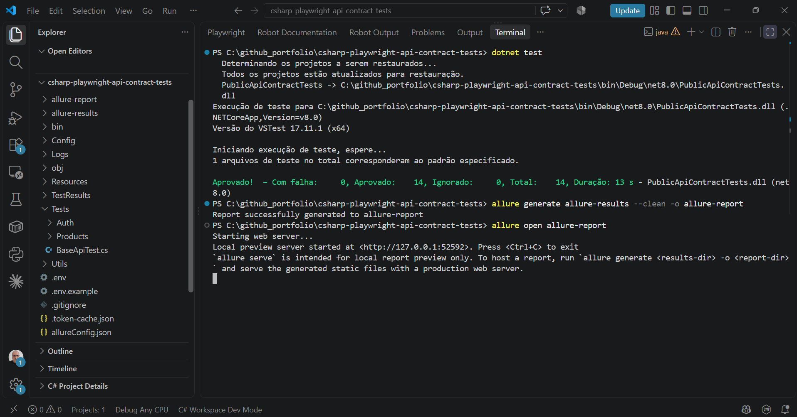
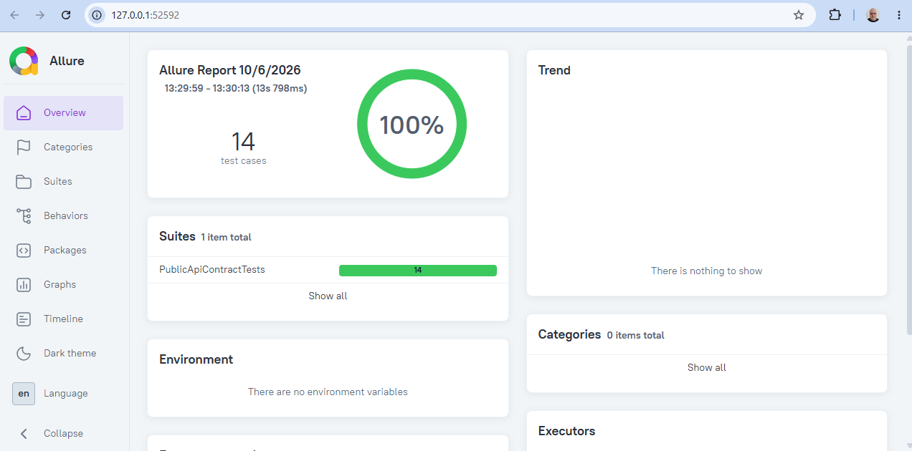
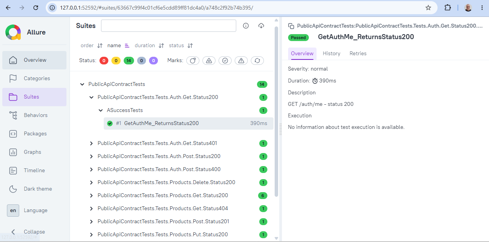

# Testes de API em C# - Contratos com API Pública (DummyJSON)

Testes de integração, schema e contrato de API pública (<https://dummyjson.com/docs>), com **C#**, **.NET** e **Playwright**.

[](https://github.com/moiseschiaretto/csharp-playwright-api-contract-tests/actions/workflows/api-tests.yml)

Versão em C# do projeto [playwright-public-api-contract-tests](https://github.com/moiseschiaretto/playwright-public-api-contract-tests) (JavaScript), mantendo a mesma arquitetura e adaptando a organização às convenções do .NET.

## 🚀 Como Começar

Pré-requisito: [.NET SDK 8 ou superior](https://dotnet.microsoft.com/download).

```bash
# 1. Clone o repositório
git clone https://github.com/moiseschiaretto/csharp-playwright-api-contract-tests.git
cd csharp-playwright-api-contract-tests

# 2. Configure o ambiente (Windows: copy .env.example .env)
cp .env.example .env

# 3. Restaure as dependências e execute os testes
dotnet restore
dotnet test
```

O token de autenticação é obtido automaticamente no início da execução, sem comando separado.

### Relatório HTML (nativo do .NET)

```bash
dotnet test --logger "html;LogFileName=relatorio.html" --results-directory TestResults
```

### Relatório Allure

Pré-requisitos: Java 8 ou superior e Allure CLI (`npm install -g allure-commandline`).

```bash
dotnet test
allure generate allure-results --clean -o allure-report
allure open allure-report
```

## 📸 Evidências

**Execução via terminal (VS Code) — 14 testes passando:**



**Estrutura do projeto no VS Code (pastas em PascalCase, padrão do C#):**



**Geração do relatório HTML via terminal:**



**Relatório HTML — visão geral (100% de sucesso, token obtido automaticamente e validações de schema e contrato):**



**Geração do relatório Allure via terminal:**



**Relatório Allure — visão geral (100% de sucesso):**



**Relatório Allure — suítes (cenários organizados por recurso, método e status):**



## Stack

- **C# / .NET 8** com **NUnit** como framework de testes
- **Microsoft.Playwright** (`APIRequestContext`) para execução das requisições HTTP
- **DotNetEnv** para leitura do arquivo `.env`
- **System.Text.Json** para validação de schema e de contrato
- **Allure.NUnit** e relatório HTML nativo do `dotnet test` para relatórios de execução
- **GitHub Actions** para CI/CD (roda a cada push e diariamente, para detectar quebras de contrato na API pública)

## Estrutura

Pastas em **PascalCase**, seguindo a convenção do C#, em que cada pasta com código corresponde a um namespace.

```
Config/
  TestEnvironment.cs      # variáveis do .env (base URL, credenciais, token)
  Endpoints.cs            # constantes de endpoints
Utils/
  RequestHelper.cs        # MakeRequestAsync() — método único para todos os verbos HTTP
  SchemaValidator.cs      # teste de schema (estrutura e tipos)
  ContractValidator.cs    # teste de contrato (valores exatos de campos estáveis)
  FileHelper.cs           # logs de response, fixtures e massas de teste
  AuthToken.cs            # autentica e cacheia o accessToken
  ProjectPaths.cs         # localiza a raiz do projeto
Tests/
  BaseApiTest.cs          # cria e libera o contexto de requisições do Playwright (com [AllureNUnit])
  {Recurso}/{Metodo}/{StatusXXX}/*Tests.cs
Resources/
  Fixtures/PublicApi/{Recurso}/{Metodo}/{StatusXXX}/*.json   # schemas esperados (amostras)
  Data/PublicApi/{Recurso}/{Metodo}/{StatusXXX}/*.json       # massas de teste (bodies)
Logs/                     # responses reais salvas a cada execução (não versionado)
docs/
  screenshots/            # capturas de tela da execução e dos relatórios
GlobalSetup.cs            # obtém o token uma vez antes de todos os testes
allureConfig.json         # define a pasta allure-results na raiz do projeto
```

## Schema x Contrato

**Teste de schema** (`SchemaValidator`): valida estrutura e tipos a partir de uma amostra em `Resources/Fixtures`, sem comparar valores. Como a API é pública e os dados mudam (preços, quantidades, IDs), validar valor por valor quebraria os testes sem motivo real. Possui dois modos: `AllowExtra` (aceita campos novos) e `ExactSchema` (rejeita campos não previstos).

**Teste de contrato** (`ContractValidator`): valida valores exatos de campos estáveis, como o título enviado no POST que precisa voltar igual na resposta, ou a confirmação `isDeleted` no DELETE.

## Logs de execução

A cada execução, a response real de cada cenário é salva em `Logs/`, com data e hora no fuso de São Paulo:

```
Logs/PublicApi/Products/Get/Status200/Products_Get_200_ASuccess_20261006_1935.json
```

## Cobertura de cenários

**14 cenários** cobrindo 2 recursos (`Auth` e `Products`), com os métodos GET, POST, PUT e DELETE e múltiplos status por método (200, 201, 400, 401 e 404).

## Credenciais

As credenciais em `.env.example` são o **usuário de demonstração publicado oficialmente pela própria DummyJSON** na documentação (<https://dummyjson.com/docs/auth>) — não são segredo de ninguém, servem só para gerar um token de teste válido.
